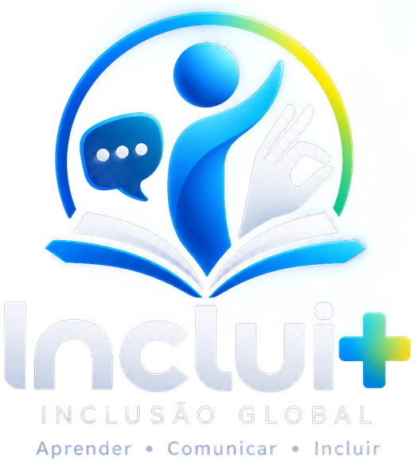

<p align="center"></p>

# Inclui+ — Inclusão Global
**Aprender • Comunicar • Incluir**

**Bilar DigitalTech Solutions** · aplicação web e móvel (PWA, instala-se no telemóvel) de tradução entre língua de sinais e voz, com intérprete virtual 3D, e ferramentas para pessoas surdas, cegas e sem fala.

## O que faz
- **O ouvinte fala ou escreve.** O intérprete 3D traduz em sinais:
  - com braços, pulsos e dedos articulados;
  - com expressão facial (sorriso, dor, perguntas com sobrancelhas);
  - com acenos e abanos de cabeça;
  - com a boca a articular a palavra.
- **A pessoa surda gesticula para a câmara.** A aplicação reconhece:
  - os gestos (Gestos);
  - as letras do alfabeto manual (Letras);
  - os sinais gravados pelos utilizadores (os seus e os validados pela comunidade);
  - **frases completas** (Frases): cada sinal é comparado por DTW com os sinais gravados; uma pausa separa os sinais e, ao baixar as mãos, a frase é dita em voz alta.

  Depois diz em voz alta o que foi reconhecido. A pessoa surda também pode escrever a resposta.
- **Quem vai usar:** no início cada pessoa escolhe o seu caminho: falo com surdos, sou surdo, ouço mal, sou cego ou vejo mal, não consigo falar, quero aprender sinais.
- **Legendas ao vivo:** tudo o que se diz à volta aparece em letras grandes (aulas, consultas, reuniões); a pessoa surda escreve a resposta e a Inclui+ diz em voz alta.
- **Alerta de sons:** campainha, alarme ou alguém a chamar → o ecrã pisca e o telemóvel vibra.
- **Orientação para pessoas cegas:** ecrã de alto contraste com botões enormes e tudo dito em voz alta, mais comandos por voz.
  - *Onde estou?* — GPS e morada pelo OpenStreetMap.
  - *O que está à minha frente?* — a câmara traseira deteta pessoas e objetos e diz a direção (esquerda, frente, direita) e se estão perto.
  - *Ler texto* — leitura de texto (OCR em português).
  - *Pedir ajuda* — ecrã vermelho, voz e vibração.
- **Cartões que falam:** para quem não fala (mudez, autismo, AVC, quem não lê). Cada cartão com imagem é dito em voz alta e o intérprete faz o sinal; os cartões juntam-se numa frase.
- **Locais:** Hospital, Escola (com quadro que escreve as palavras), Empresa e Atendimento.
- **Gravar sinais (a aplicação aprende):** a câmara vê o corpo, as duas mãos e o rosto. Modo automático (começa quando as mãos sobem, acaba quando descem — grava várias palavras seguidas) ou manual (3-2-1). Funciona em qualquer língua de sinais. Cada sinal gravado passa a ser feito pelo intérprete e reconhecido pela câmara.
- **Base partilhada, conta opcional:** os sinais partilhados vão para a base comum e, depois de validados pela comunidade (3 votos 👍) ou por um validador, ficam disponíveis para **todos, com ou sem conta**. Sem conta, a aplicação usa uma sessão anónima. Com conta (e-mail ou Google) a pessoa organiza o seu ambiente, treina os seus próprios sinais e recupera tudo noutro dispositivo.
- **Camarim:** 28 intérpretes com o rosto de cada um — pessoas negras, mulheres de lenço, médicos, executivos, jovens e idosos — agrupados em Dia a dia, Saúde, Escritório e Personalizáveis. Toca-se no rosto e a pessoa passa a ser o intérprete do local; a "Loja de roupa e cabelo" abre o estúdio para vestir peça a peça. Também se abre tocando no nome do intérprete.
- **Entrada:** "Começar sem conta" ou "Entrar ou criar conta" (nome de utilizador e palavra-passe, e-mail ou Google). O botão "Baixar a aplicação" está sempre na abertura e na primeira visita aparece uma barra a convidar a instalar.
- **Bandeiras** em imagem em todas as línguas (os emoji de bandeira não aparecem no Windows).
- **Modelo 3D:** humanos realistas (pessoas negras digitalizadas: médica, executiva, executivo, homem jovem; e duas pessoas claras) ou ilustrado (qualquer tom de pele) — escolhe-se no estúdio. Cada local escolhe sozinho o humano realista com o tom de pele e a roupa da profissão.
- **Fundo do intérprete:** cenário (consultório, sala de aula, escritório, receção, estúdio) em tom claro, médio ou escuro; cor lisa (branco, cinzento, azul-escuro, preto, verde, verde-croma, azul-claro, bege) ou degradê. Um fundo mais escuro dá mais contraste às mãos.
- **Estúdio do avatar** (separadores Pessoa · Cabelo · Roupa · Fundo):
  - nome, profissão, mulher ou homem, modelo, 6 tons de pele (incluindo albino), idade, corpo, óculos e barba;
  - cabelo a partir da cabeça rapada: curto, afro, tranças, rastas, coque, rabo-de-cavalo, comprido liso, com comprimento, volume e 7 cores;
  - roupa peça a peça em qualquer modelo (também no humano realista): camiseta, camisa, sem mangas, vestido; calças, calções, saia; casaco ou bata; gravata; 15 cores. Fardas prontas: bata médica com estetoscópio, enfermagem, professor, executivo, atendimento.
- **Mãos sólidas:** as mãos não atravessam o corpo, a cabeça, a bata nem a outra mão; dedos e pulsos têm limites anatómicos.
- **Línguas:** LSM (Moçambique), Libras (Brasil), LGP (Portugal), ASL (EUA) e LSE (Espanha). A língua escolhida muda a voz (ouvir e falar), as frases e as palavras reconhecidas.
- **Aprender:** 100 sinais por tema, alfabeto manual e números.
- **Professor virtual (🎓 Perguntar):** o aluno pergunta por voz ou por escrito. O professor:
  - responde com voz;
  - mexe os lábios sincronizados com a fala;
  - mostra expressão (pensar, sorrir…);
  - olha com naturalidade;
  - faz os sinais das palavras-chave.

  Usa IA (Claude) no servidor e procura informação complementar na Wikipédia em português, inglês ou espanhol; mostra as fontes consultadas. Isto acrescenta referências durante a pergunta, sem treinar nem alterar o modelo de IA. Sem chave de IA, as perguntas conhecidas usam o modo offline e outras podem mostrar um excerto público com a respetiva fonte.
- **Conversa:** registo com hora; partilhar por WhatsApp/e-mail.
- **Instalar no telemóvel:** botão "Instalar" (Android/computador) ou "Adicionar ao ecrã principal" (iPhone); funciona sem internet depois da primeira visita.
- **Acessibilidade:** texto grande, alto contraste, vibração, velocidade dos sinais.

## Executar
| Como | O que fazer |
|---|---|
| **Duplo clique** | Abra `index.html` no Chrome ou no Edge. Funciona sem servidor e sem internet para o avatar. A câmara e o microfone pedem autorização. |
| Com servidor (professor com IA) | `npm start` e abra http://localhost:5173 |
| **GitHub Pages** (recomendado) | Ver "Publicar no GitHub" abaixo. Fica em `https://<utilizador>.github.io/inclui-mais/`. |
| Netlify | Arraste a pasta para app.netlify.com/drop. |

Programadores: edite `dev.html` e `js/` (módulos ES) e depois corra `npm run build`. Isto gera `index.html` e `app.js`, que abrem com duplo clique, e `dist-artifact/`, a versão de página única alojável.
As imagens de abertura (`assets/brand/hero.jpg` para computador e `hero-m.jpg` para telemóvel) são geradas com os próprios avatares por `tools/make-hero.py`. Para usar fotografias reais (com autorização das pessoas), substitua esses ficheiros e corra `npm run build`.

## Publicar no GitHub
1. Crie um repositório vazio em github.com (ex.: `inclui-mais`).
2. Nesta pasta, abra um terminal e corra:
   ```bash
   git init -b main
   git add .
   git commit -m "Inclui+ 2.0"
   git remote add origin https://github.com/<utilizador>/inclui-mais.git
   git push -u origin main
   ```
   (Sem terminal: no GitHub, "Add file → Upload files" e arraste o conteúdo da pasta.)
3. No repositório: **Settings → Pages → Source: GitHub Actions**. O ficheiro `.github/workflows/pages.yml` constrói e publica automaticamente a cada alteração.
4. Abra `https://<utilizador>.github.io/inclui-mais/` no telemóvel e toque em **Instalar** (ou "Adicionar ao ecrã principal").

O site publicado (https) tem tudo a funcionar: câmara, microfone, legendas, orientação para cegos e instalação no telemóvel. O professor com IA e pesquisa de fontes precisa do servidor Node.js (`server/`), alojado à parte (Render, Railway…), com `ANTHROPIC_API_KEY` configurada e acesso à internet. A pesquisa usa a API pública da Wikipédia; sem servidor, a aplicação usa o modo offline.

## Firebase (contas e base de sinais partilhada)
A configuração do projeto `inclui-mais` já está em `assets/firebase-config.js` (estas chaves Web são públicas por natureza; a segurança está em `firestore.rules`). Sem internet, tudo continua a funcionar no dispositivo.

- **Sem conta:** sessão anónima automática. Pode usar todos os sinais validados e gravar/partilhar sinais.
- **Com conta (opcional):** e-mail e palavra-passe ou Google. Os sinais gravados como anónimo passam para a conta. Noutro telemóvel, ao entrar, voltam o perfil, as preferências, os avatares, o local, a língua de sinais e os sinais próprios.
- **Validação:** cada sinal partilhado fica *pendente*; com 3 votos 👍 (e menos de metade de 👎) fica *aprovado*; com 3 👎 (e mais 👎 que 👍) é *rejeitado*. Validadores (documentos `admins/{uid}`) aprovam ou rejeitam diretamente.
- **Conversas** só vão para a nuvem se a pessoa ligar a opção (podem ter dados de saúde).

Passos na consola (console.firebase.google.com, projeto `inclui-mais`):
1. **Authentication → Sign-in method:** ative *Anónimo*, *E-mail/palavra-passe* e *Google*.
2. **Authentication → Settings → Authorized domains:** acrescente `bilar7.github.io` (e o domínio próprio, se houver).
3. **Firestore Database → Criar base de dados** e cole as regras de `firestore.rules` em *Regras* (ou `firebase deploy --only firestore:rules`).
4. Validadores: crie a coleção `admins` com um documento cujo ID é o UID da pessoa (Authentication → Users).
5. Se a consola do navegador pedir um índice para `signs` (sl + status), abra a ligação do erro para o criar.
6. (Opcional) Alojar no Firebase: `npm i -g firebase-tools`, `firebase login`, `firebase deploy`.

Dados: `users/{uid}` (perfil e ambiente), `users/{uid}/signs` (sinais próprios), `users/{uid}/conversations`, `signs/{id}` (base partilhada com estado e votos), `admins/{uid}`.

## Estrutura
```
index.html + app.js     versão pronta (gerada) — abre com duplo clique
dev.html                estrutura da página (fonte) que carrega os módulos js/
tools/build.mjs         gera index.html, app.js, modelos em partes (.glb.N.js) e dist-artifact/
css/app.css             sistema visual (cores, tipografia, layout responsivo)
js/main.js              arranque e ligação entre módulos
js/core/                preferências, voz, línguas, locais e frases
js/sign/                vocabulário, alfabeto manual e tradutor frase → sinais
js/avatar/rig.js        cinemática inversa dos braços e articulações anatómicas dos dedos
js/avatar/handshapes.js configurações de mão em graus (MCP, PIP, DIP, polegar)
js/avatar/avatar.js     palco 3D, animação, rosto (ARKit), enquadramento
js/avatar/customize.js  pele, idade, corpo, fardas e acessórios
js/avatar/hair.js       cortes de cabelo 3D moldados à cabeça
js/avatar/wardrobe.js   guarda-roupa: peças geradas a partir da malha de cada modelo
js/avatar/scenes.js     cenários (consultório, sala de aula com quadro, escritório, balcão)
js/vision/              câmara, descritor da mão e reconhecimento (MediaPipe + k-vizinhos)
js/ui/                  estúdio, aprender, orientação para cegos, cartões que falam, legendas ao vivo e alerta de sons
vendor/three/           Three.js r170 (local, sem depender de CDN)
assets/avatars/         modelos 3D (.glb) e as suas partes embutidas
assets/brand, icons/    logótipo, imagens de abertura e ícones da aplicação
.github/workflows/      publicação automática no GitHub Pages
tools/                  build.mjs, verificador de modelos (avatar-check) e gerador das imagens de abertura (make-hero)
server/                 servidor Node.js: aplicação, /api/tutor (IA), /api/speech (Piper + Audio2Face)
server/a2f/             serviço Python NVIDIA Audio2Face-3D (pesos ARKit a partir da voz)
pipeline/metahuman/     MetaHuman → Blender → GLB leve (scripts e guia)
assets/avatars/avatars.json  catálogo de modelos (padrão e realistas)
sw.js, manifest         instalação como aplicação e funcionamento sem internet
js/core/cloud.js        Firebase: conta, sincronização, conversas e gestos partilhados
assets/firebase-config.js  configuração do Firebase (null = sem nuvem)
firebase.json, firestore.rules  alojamento e regras de segurança do Firebase
```

## Como funcionam os dedos
Cada configuração de mão é definida em **ângulos anatómicos** (graus nas articulações MCP, PIP e DIP, e abertura entre os dedos). Os eixos de dobra de cada articulação são **calibrados automaticamente** em cada avatar.

A posição do **polegar** é calculada por **cinemática inversa**: a aplicação procura os ângulos que levam a ponta do polegar ao sítio certo (ao lado do indicador no A, sobre os dedos no S, dobrado na palma no B, frente aos dedos no O).


**Corpo sólido.** Ao carregar um avatar, a aplicação mede o tronco (fatias com largura e profundidade reais, incluindo a roupa) e a cabeça a partir da própria malha. Em cada fotograma, as mãos são afastadas para fora do corpo e uma da outra antes de calcular o braço. Assim tocam-se (no peito, no queixo, mão com mão), mas não se atravessam.

**Cabelo.** Os cortes são gerados em 3D e moldados à forma da cabeça de cada modelo (`js/avatar/hair.js`). Escolher um corte esconde o cabelo original do modelo.

**Roupa.** Cada peça é recortada da superfície da roupa original do modelo, com os mesmos pesos dos ossos, por isso acompanha todos os movimentos. A bainha fica exatamente no sítio escolhido (meio do braço, joelho, tornozelo). O que deixa de estar coberto aparece como pele, e a saia e a bata são sólidas para as mãos (`js/avatar/wardrobe.js`).

O reconhecimento das letras pela câmara treina-se a partir do **próprio avatar**: a aplicação gera exemplos dos 21 pontos da mão para cada letra.

## Professor virtual com IA
1. Copie `server/.env.example` para `server/.env`.
2. Preencha `ANTHROPIC_API_KEY`.
3. Corra `npm start`.

Opcional:
- **voz do servidor:** Piper (`PIPER_BIN`, `PIPER_VOICE_PT`);
- **rosto gerado pela voz:** Audio2Face (`A2F_SIDECAR_URL`, ver `server/a2f/`).

## Avatares humanos realistas
- **24 pessoas digitalizadas (uso comercial permitido):** `realistic/*.glb` (ver `assets/avatars/avatars.json`) — Microsoft Rocketbox (licença MIT); rostos do camarim em `assets/avatars/thumbs/`, convertidos de FBX para GLB com 52 expressões ARKit e visemas para a boca. Vêm já vestidos; o cabelo e a roupa não se trocam.
- **Pessoas claras:** `realistic/humana.glb`, `humano.glb` — uso não comercial.
- O motor reconhece esqueletos Mixamo/Ready Player Me, Unreal/MetaHuman e 3ds Max Biped (Rocketbox). Para o clone de uma pessoa real (com o consentimento dela), exporte um .glb com esqueleto humanoide e acrescente-o a `assets/avatars/avatars.json`. MetaHuman: ver `pipeline/metahuman/README.md`.

## Tecnologias e caminho para o avatar fotorrealista

| Peça | Hoje | Próximo passo |
|---|---|---|
| Humano 3D | Pessoas negras realistas (Rocketbox, MIT), humanos claros (Avaturn/Avatar SDK) e ilustrado (Ready Player Me) | **MetaHuman** (Unreal Engine 5.6+), exportado para Blender |
| Preparação | — | **Blender**: reduzir polígonos/LOD, texturas de 1–2K, 52 expressões ARKit, exportar .glb comprimido (meshopt) |
| Mostrar na web | **Three.js** r170 | Igual. O motor já reconhece esqueletos MetaHuman/Unreal (`upperarm_l`, `index_01_l`…) e modelos comprimidos |
| Rosto ao falar | Expressões ARKit + articulação da boca por letras | **NVIDIA Audio2Face-3D**: voz → pesos ARKit enviados para `interpreter.setFaceWeights()` |
| Servidor | Não é preciso (tudo corre no telemóvel) | **Node.js** para IA do professor virtual, voz sintética, Audio2Face e chaves secretas |
| Reconhecimento | MediaPipe (corpo, mãos, rosto) + k-vizinhos + DTW para frases | Rede treinada com a base partilhada de sinais validados |

Metas de desempenho para telemóvel: avatar abaixo de 15 MB, texturas até 2K, 60 fps em telemóveis médios.

## Créditos e licenças
- Three.js — MIT.
- Avatares realistas de pessoas negras: Microsoft Rocketbox Avatar Library — **MIT** (uso comercial permitido; manter o aviso de copyright).
- Avatares realistas claros: `realistic/humana.glb` (Avaturn) e `realistic/humano.glb` (Avatar SDK), via met4citizen/TalkingHead — **uso não comercial**.
- Deteção de objetos: MediaPipe EfficientDet-Lite0 (Apache 2.0). OCR: Tesseract.js (Apache 2.0). Moradas: © colaboradores do OpenStreetMap (Nominatim).
- Avatares de demonstração: `feminino.glb` (Ready Player Me, CC BY-NC 4.0, via met4citizen/TalkingHead) e `masculino.glb` (exemplo Ready Player Me do Three.js). **Uso não comercial.** Para lançamento comercial, substituir por avatares próprios (MetaHuman ou artista 3D).
- MediaPipe — Apache 2.0.
- Bandeiras: flag-icons (Panayiotis Lipiridis) — MIT.
- Vocabulário de sinais: **demonstração**. O vocabulário oficial é gravado com intérpretes certificados e com a comunidade surda (em Moçambique, com a ASUMO).
